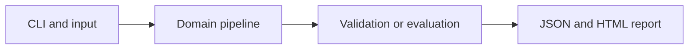

# Neural Microscopy Foreground Segmentation

Train a small neural pixel classifier on synthetic microscopy scenes and evaluate on separate images.

**Category:** Biology / Deep Learning

**Execution:** Actual local algorithm or workflow; no external model service required.

## Run

```sh
python -m venv .venv
# Windows: .venv\Scripts\activate
# macOS/Linux: source .venv/bin/activate
python -m pip install -r requirements.txt
python app.py
python -m unittest discover -v
```

Open `results/report.html` after running. Python 3.10+ is required. Use `--help` for input and seed options.

## Architecture



## Algorithm

Extract local 3x3 pixel windows and classify each center pixel using an eight-unit tanh hidden layer and logistic output. Backpropagate binary cross entropy through both layers.

## Evaluation

Train and validate on entire independent images rather than randomly splitting neighboring pixels. Select the probability threshold on validation images and report test intersection over union against an intensity threshold baseline.

## Limitations

Synthetic circles stand in for cells. This predicts foreground pixels, not separate cell instances, and does not reproduce CellSAM or clinical pathology performance.

## Documentation

- [PDF project guide](PROJECT_GUIDE.pdf)
- [Editable guide](GUIDE.md)
- [Model and system card](MODEL_CARD.md)
- [Measured results](results/metrics.json)
- [Test output](TEST_RESULTS.txt)

## Extend it

Use licensed microscopy masks, split by specimen, compare U-Net and pretrained models, and measure instance-level segmentation errors.

AI-assisted educational project with synthetic data. Review, customize and explain your own contribution accurately. MIT license.

## Biology scope and current relevance

Default inputs are synthetic or project-authored. No clinical deployment or wet-lab validation is claimed. See [research context](RESEARCH_CONTEXT.md) and [data provenance](DATA_PROVENANCE.md).

- [CellSAM: a foundation model for cell segmentation](https://www.nature.com/articles/s41592-025-02879-w) (2025)
